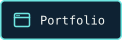
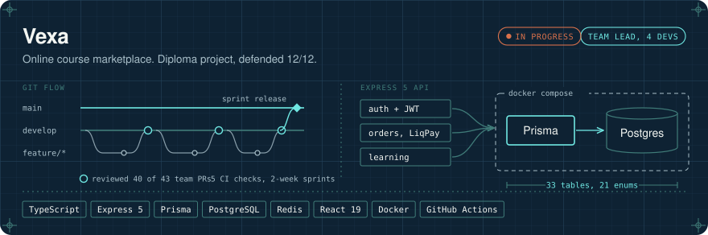
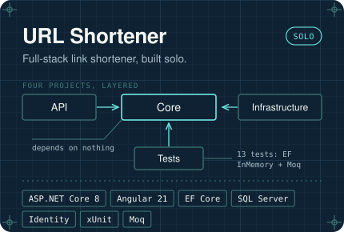
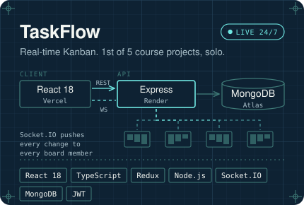
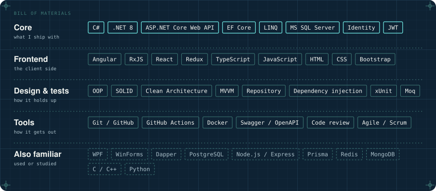

<!-- Every image in this README is generated by tools/build_assets.py. Edit the text there, not in the SVGs. -->

  
  
  
  

I write backends in C# and ASP.NET Core and the Angular or React client on top of them. In October I graduated from IT STEP Academy; the diploma project was **Vexa**, a course marketplace where I led four developers, wrote the 55-page spec and reviewed 40 of 43 of my teammates' pull requests. Now looking for my first commercial role.

## Selected work

Each project is drawn as its own system. Click a sheet to open the repository.

  

  
  
  
  

TaskFlow is live at **[react-course-work-mu.vercel.app](https://react-course-work-mu.vercel.app)**. The jury at the Vexa defense called it the strongest project in the last couple of years; the demo is on [YouTube](https://youtu.be/1U90UNY5lus). More on how each one is built is on [my site](https://anton-portfolio-ten.vercel.app/#work).

<b>Smaller projects</b>

 

| Project | What it is | Built with |
| :-- | :-- | :-- |
| [MyPomodoro Timer](https://github.com/terekh373/MyPomodorroTimer) | Every Pomodoro app with custom intervals was paid, so I wrote a free one | C#, WinForms |
| [WPF Audio Player](https://github.com/terekh373/WPF_AudioPlayer) | Desktop music player with a playlist, inspired by Spotify's layout | C#, WPF |
| [Words Game](https://github.com/terekh373/WordGame_Cplusplus) | Wordle clone for the terminal; I led a team of three and wrote the game logic | C++17, OOP |
| [Shop app](https://github.com/terekh373/EXAM_ASPdotNETCore) | Online shop, final exam of the ASP.NET Core course | ASP.NET Core MVC, EF Core |

## Toolbox

## Background

| Where | What | When |
| :-- | :-- | :-- |
| IT STEP Computer Academy | Software development diploma, average 11.8 of 12 | 2022 – 2026 |
| Kharkiv University of Technology "STEP" | BSc, Information Systems and Technologies (F6), in progress | 2025 – 2029 |

Languages: Ukrainian (native), English (B2), German (A2–B1).

Open to remote and outstaff roles, or an office in Kharkiv. Email is the fastest way to reach me: **anton.e.tereshchenko@gmail.com**
